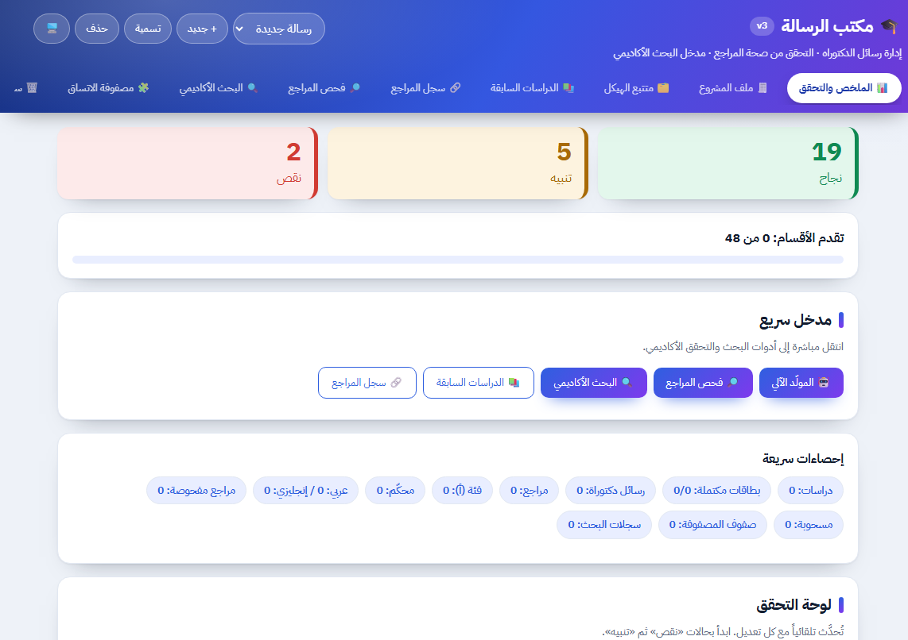
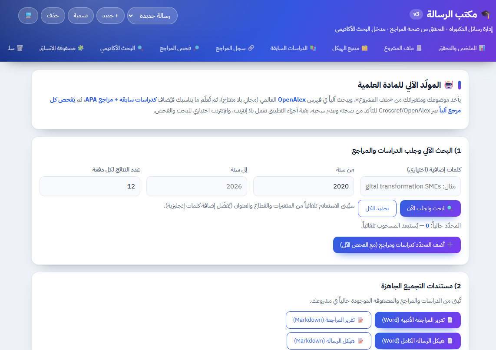
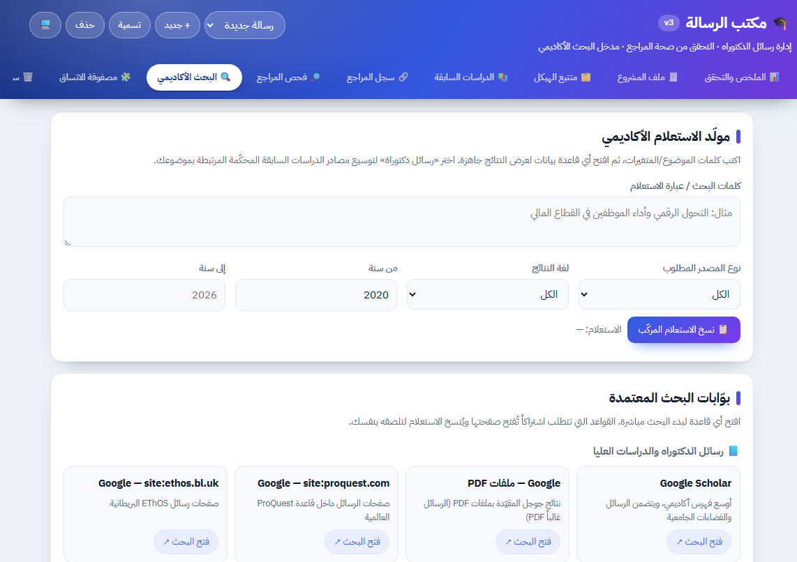
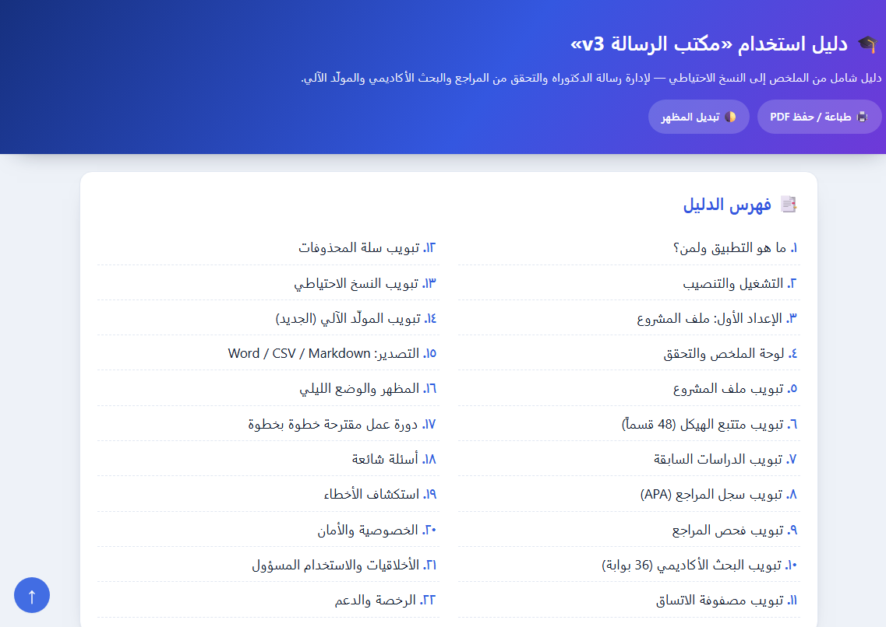
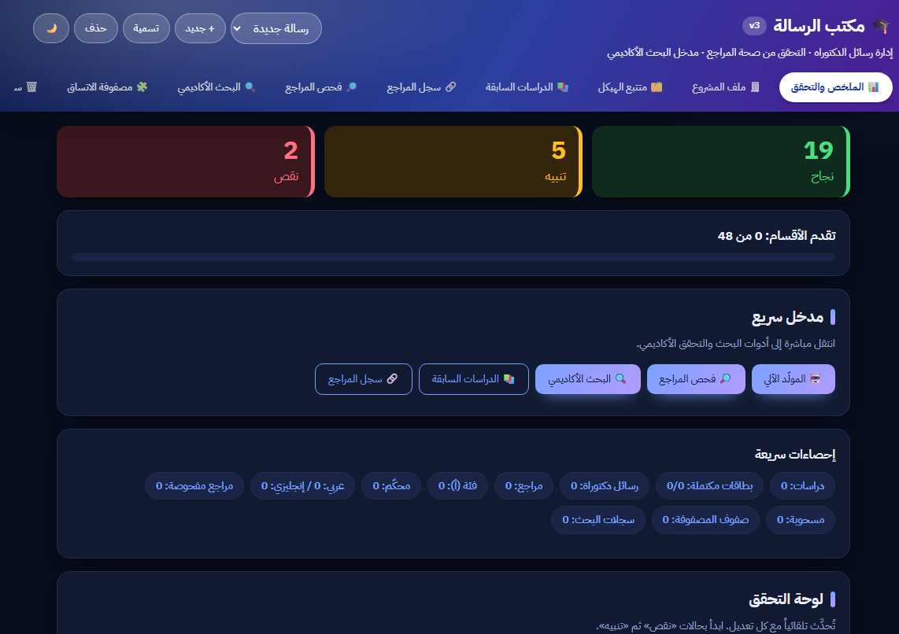

<p align="center">
  
</p>

<h1 align="center">🎓 مكتب الرسالة — Thesis Desk (v3)</h1>

<p align="center">
  <b>مساعد ذكي لإدارة رسالة الدكتوراه المهنية (DBA)</b><br>
  من تحليل العنوان ومسار الرسالة، إلى الدراسات السابقة وسجل المراجع والبحث الأكاديمي وتصدير Word.
</p>

<p align="center">
  <a href="https://ahmedawe2026-svg.github.io/DBA-Thesis-Assistant-Mobile/"><b>🌐 تجربة مباشرة</b></a>
  &nbsp;·&nbsp;
  <a href="docs/guide.html">📖 دليل الاستخدام</a>
  &nbsp;·&nbsp;
  <a href="README.en.md">English</a>
</p>

<p align="center">
  
  
  
  
  
  
  
  
</p>

> [!IMPORTANT]
> **⚠️ تنبيه أخلاقي وعلمي:** هذا التطبيق **أداة مساعدة** للجمع والفحص والتنسيق، وليس بديلاً عن الباحث أو المشرف. يجب مراجعة كل مُخرَج وتحريره والتحقق منه، والالتزام بسياسة جامعتك بشأن أدوات المساعدة. النصوص المولّدة آلياً مسوّدات أولية فقط، ولا يختلق التطبيق نتائج أو مراجع.

---

## 📌 نظرة عامة

**مكتب الرسالة (Thesis Desk)** تطبيق ويب عربي (RTL) لإدارة رسالة الدكتوراه المهنية (DBA) من البداية حتى الاستبيان. يجمع في مكان واحد ما يلي:

- **تحليل العنوان** واستخراج المتغيرات والصياغات البديلة.
- **مسار الرسالة** (المشكلة، الأهداف، الأسئلة، الفرضيات، المنهج، العينة، الأداة، الإحصاء).
- **الدراسات السابقة** وسجل **المراجع** بتوثيق APA 7.
- **فحص صحة المراجع** عبر Crossref و **البحث الأكاديمي** عبر OpenAlex وأكثر من 35 بوابة.
- **مصفوفة الاتساق** بين الفجوة والسؤال والهدف والفرضية والأداة والنتيجة والتوصية.
- **تصدير حقيقي لملف Word (.docx)** عربي من داخل المتصفح بلا أي مكتبات.
- **ذكاء اصطناعي محلي** اختياري عبر Ollama (يعمل على الحاسوب فقط، دون خادم ودون مفتاح API).

يعمل التطبيق **دون إنترنت** في معظم الوظائف (كل البيانات تُحفظ محلياً في متصفّحك)، ويستخدم الإنترنت اختيارياً للبحث الأكاديمي وفحص المراجع فقط.

---

## 🖼️ لقطات الشاشة

<p align="center">
  
  
</p>
<p align="center">
  
  
</p>
<p align="center">
  
</p>

---

## ✨ المزايا الرئيسية

### 🧭 الشاشة والتنقّل
يبدأ التطبيق من **🏠 البداية** (إدخال عنوان الرسالة وتحليله)، ويعرض **6 تبويبات أساسية** مع زر **«⚙ المزيد»** لإظهار بقية التبويبات:

| التبويب | الوظيفة |
|---|---|
| 🏠 البداية *(أساسي)* | إدخال عنوان الرسالة، تحليله آلياً، اقتراح متغيرات وصياغات بديلة، وبحث سريع عن الدراسات. |
| 🧭 مسار الرسالة *(أساسي)* | توليد مسودة كاملة للمشكلة والأهداف والأسئلة والفرضيات والمنهج والعينة والتحليل الإحصائي + حاسبة حجم العينة + فحص التناقضات. |
| 📚 الدراسات السابقة *(أساسي)* | بطاقات الدراسات (13 حقلاً) مصنّفة بالمحاور (مستقل/تابع/وسيط...). |
| 🔗 سجل المراجع *(أساسي)* | توثيق APA 7 + تصنيف (أ/ب/ج) + محكّم/لغة + تبرير الاختيار. |
| 🤖 المولّد الآلي *(أساسي)* | بحث آلي في OpenAlex + فلترة السحب/بلا DOI + إضافة تلقائية للدراسات والمراجع + فحص آلي. |
| 💾 النسخ والاستيراد *(أساسي)* | تصدير/استيراد المشاريع + لقطات (Snapshots) + استيراد BibTeX / RIS / docx. |
| 📊 الملخص والتحقق | لوحة تقدّم + نتائج قواعد التحقق (أكثر من 25 قاعدة) وإحصاءات. |
| 🧾 ملف المشروع | العنوان، القطاع، المتغير المستقل/التابع/الوسيط، والحد الأدنى لسنوات الدراسات. |
| 🗂️ متتبع الهيكل | 7 أجزاء و48 قسماً مع حالة كل قسم وملاحظات المشرف. |
| 🔎 فحص المراجع | فحص مباشر لكل مرجع عبر Crossref و OpenAlex. |
| 🔍 البحث الأكاديمي | أكثر من 35 بوابة بحث في 4 مجموعات + مولّد الاستعلامات. |
| 🧩 مصفوفة الاتساق | ربط الفجوة/السؤال/الهدف/الفرضية/الأداة/النتيجة/التوصية. |
| 🗑️ سلة المحذوفات | استعادة العناصر المحذوفة. |

### 🏠 تحليل العنوان (Start)
- تحليل قائم على قواعد عربية/إنجليزية لأنماط العنوان: **أثر / دور / علاقة**، المتغير الوسيط، ومجال التطبيق.
- ملاحظات أكاديمية على العنوان (الطول، الصياغة السببية، غياب مجال التطبيق) + **أربعة عناوين بديلة** مع تبرير لكل منها.
- جدول مبسّط للمفاهيم والأبعاد الشائعة مع مصدرها المؤسِّس (يجب التحقق منها من المصدر الأصلي).
- زر **«ابحث عن الدراسات»** لجلب دراسات حقيقية من OpenAlex بكلمات مفتاحية إنجليزية مقترحة آلياً.

### 🧭 مسار الرسالة
- توليد مسودة لمشكلة الدراسة والأهداف والأسئلة والفرضيات والإطار النظري والمنهج والمجتمع والعينة والأداة والتحليل الإحصائي — استناداً إلى عنوانك ومتغيراتك فقط.
- أي نص بين **[ ]** يعني معلومة يجب أن تستبدلها بنفسك؛ أما **النتائج والتوصيات فلا تُكتب تلقائياً** قبل جمع بياناتك الحقيقية.
- **حاسبة حجم العينة** (معادلة Cochran مع تصحيح المجتمع المنتهي).
- **فاحص الاتساق** يكشف: الأقسام الناقصة، أي [ ] لم تُستبدل، وسيطاً بلا تحليل وساطة، منهجاً نوعياً مع تحليل كمّي، صياغة «أثر» مع «علاقة»، عينة أقل من الحد الأدنى، أداة بلا صدق/ثبات.

### 🤖 المولّد الآلي
- **بحث آلي** في فهرس **OpenAlex** العالمي بناءً على متغيرات المشروع + كلمات إضافية.
- يستبعد تلقائياً الأعمال **المسحوبة (Retracted)** والتي بلا DOI.
- **إضافة تلقائية**: دراسة سابقة + مرجع بتوثيق APA مولّد آلياً.
- **فحص آلي** لكل مرجع مُضاف عبر Crossref/OpenAlex.
- **مخرجات جاهزة للتصدير** (Word / Markdown): تقرير المراجعة الأدبية، وهيكل الرسالة الكامل (مع الدراسات والمصفوفة والمراجع)، ومولّد مسودة نصّية عبر النموذج المحلي.

### 🤖 الذكاء الاصطناعي المحلي (Ollama)
- توليد نصّي عبر نموذج محلي على جهازك (`/api/chat`) — **بلا خادم وبلا مفتاح API وبلا اشتراك**.
- العنوان الافتراضي: `http://localhost:11434` والنموذج الافتراضي: `qwen2.5:3b`.
- زر **«🔌 اختبر الاتصال بـ Ollama»** يسرد النماذج المثبّتة، ورسائل خطأ عربية واضحة (Ollama غير مشغّل / النموذج غير مثبّت / انتهت المهلة).
- ⚠️ يعمل على **الحاسوب فقط**، ولا يتوفّر على الهاتف.

### 📥 الاستيراد والتصدير
- **استيراد المراجع**: BibTeX و RIS.
- **استيراد الملفات**: txt / md / csv / docx مع استخراج DOI وجلب بياناته من Crossref (لا يدعم PDF).
- **تصدير**: ملف **Word (.docx) عربي RTL حقيقي** (عناوين وجداول) مُبنى داخل المتصفّح بلا مكتبات، بالإضافة إلى CSV و Markdown.

---

## 🗂️ بنية المستودع

```
DBA-Thesis-Assistant-Mobile/
├── index.html                       # الصفحة الرئيسية (نسخة النشر والتطوير)
├── sw.js                            # Service Worker (عمل دون إنترنت)
├── manifest.webmanifest             # ملف تعريف PWA
├── assets/
│   ├── css/style.css                # كل الأنماط (نهاري/ليلي تلقائي + تحسينات الهاتف)
│   ├── js/app.js                    # كل منطق التطبيق
│   └── img/                         # الشعار والأيقونات (192/512/maskable/apple)
├── standalone/
│   └── thesis-desk-v3.html          # نسخة مكتفية ذاتياً (ملف واحد يعمل في أي مكان)
├── docs/
│   └── guide.html                   # دليل الاستخدام الشامل (22 قسماً، قابل للطباعة PDF)
├── mobile/                          # غلاف أندرويد (Capacitor 6)
│   ├── capacitor.config.json
│   └── package.json
├── screenshots/                     # لقطات الشاشة
├── README.md                        # التوثيق العربي
├── README.en.md                     # التوثيق الإنجليزي
├── CHANGELOG.md                     # سجل التغييرات
├── CONTRIBUTING.md / CODE_OF_CONDUCT.md / SECURITY.md
├── LICENSE                          # MIT
└── .github/workflows/               # CI + بناء APK
```

> **ملاحظة — نسختان للتشغيل:**
> - `index.html` + `assets/` → للتطوير والنشر عبر GitHub Pages.
> - `standalone/thesis-desk-v3.html` → ملف واحد جاهز للاستخدام المباشر بمجرد فتحه في المتصفّح.

---

## 🚀 التشغيل

### الطريقة الأولى — فتح مباشر (الأسهل)
افتح الملف `standalone/thesis-desk-v3.html` في متصفّحك مباشرةً (Chrome / Edge / Firefox).

### الطريقة الثانية — نسخة المطوّر
افتح `index.html` مباشرة، أو شغّل خادماً محلياً:

```bash
# Python
python -m http.server 8080

# Node
npx serve .
```
ثم افتح `http://localhost:8080`.

### الطريقة الثالثة — عبر الإنترنت (GitHub Pages)
الموقع مُفعّل على:
**https://ahmedawe2026-svg.github.io/DBA-Thesis-Assistant-Mobile/**

### سكربتات تشغيل جاهزة (مع الذكاء المحلي)
- Windows: شغّل **«تشغيل المساعد (Windows).bat»** (أغلق Ollama أولاً إن كان يعمل بجانب الساعة).
- Mac/Linux: شغّل **«تشغيل المساعد (Mac-Linux).sh»**.

---

## 🤖 تجهيز الذكاء المحلي (اختياري)

1. حمّل **Ollama** من [ollama.com/download](https://ollama.com/download).
2. ثبّت النموذج (افتح CMD):
   ```bash
   ollama pull qwen2.5:3b
   ```
3. افتح التطبيق، ثم من تبويب المولّد الآلي اضغط **«🔌 اختبر الاتصال بـ Ollama»**.

**حسب ذاكرة جهازك:**
- 4 جيجابايت → `qwen2.5:1.5b` (أضعف جودة).
- 8 جيجابايت → `qwen2.5:3b` (الافتراضي).
- 16 جيجابايت فأكثر → يمكن تجربة `qwen2.5:7b` (أبطأ وأفضل).

لا يلزم كرت شاشة، لكنه يسرّع التوليد.

---

## 📱 على الهاتف والتطبيقات

### تثبيت التطبيق (PWA)
التطبيق **قابل للتثبيت** على أندرويد وآيفون من نفس الرابط:
- **Chrome (أندرويد):** ⋮ ← **تثبيت التطبيق** (أو زر «📲 ثبّت التطبيق» أعلى الصفحة).
- **Samsung Internet:** ☰ ← **Add page to** ← **Home screen**.
- **آيفون (Safari):** زر المشاركة ← **إضافة إلى الشاشة الرئيسية**.

يمكن تصفح دليل التثبيت المفصّل في [`دليل الزملاء للهاتف.md`](دليل%20الزملاء%20للهاتف.md).

### ملف APK لأندرويد (اختياري)
يحتوي المستودع على غلاف **Capacitor 6** (`mobile/`) وسَكّ عمل لبناء ملف APK تجريبي (debug) مجاناً داخل GitHub Actions:
1. من تبويب **Actions** اختر **Build Android APK** ← **Run workflow**.
2. بعد انتهاء التشغيل نزّل `dba-desk-apk` من قسم Artifacts، وفكّ الضغط لتحصل على `app-debug.apk`.

> هذا ملف تجريبي يُثبَّت يدوياً وليس من متجر Google Play، والتحديثات فيه يدوية.

---

## 🔐 الخصوصية والبيانات

- كل البيانات تُحفظ في **متصفّحك فقط** (`localStorage` بالمفتاح `thesis-desk-v2`) ولا تُرسَل إلى أي خادم.
- عمليات البحث والفحص تتصل بواجهات عامة مجانية:
  - [OpenAlex](https://api.openalex.org) — بحث الفهارس.
  - [Crossref](https://api.crossref.org) — فحص DOI والتوثيق.
- إعدادات النموذج المحلي تُحفظ محلياً فقط (`td-llm`)، ولا يُخزَّن أي مفتاح API (أُزيل تلقائياً إن وُجد من نسخة قديمة).
- عند البحث يتصل جهازك مباشرة بـ OpenAlex وCrossref (فيرى هذان الموقعان عنوان الإنترنت وكلمات البحث).
- **احمِ عملك:** صدّر نسخة احتياطية (JSON) دورياً، لأن مسح بيانات المتصفّح قد يحذف مشروعك.

---

## ⚠️ تنبيه أخلاقي وعلمي
هذا التطبيق **أداة مساعدة** للجمع والفحص والتنسيق، وليس بديلاً عن الباحث أو المشرف. يجب مراجعة كل مُخرَج وتحريره والتحقق منه، والالتزام بسياسة جامعتك بشأن أدوات المساعدة. النصوص المولّدة آلياً مسوّدات أولية فقط، ولا يكتب التطبيق نتائجك ولا يختلق مراجع.

---

## 📖 دليل الاستخدام
دليل مفصّل يشرح كل تبويب خطوة بخطوة (22 قسماً):

- الملف: [`docs/guide.html`](docs/guide.html)
- مباشر: https://ahmedawe2026-svg.github.io/DBA-Thesis-Assistant-Mobile/docs/guide.html

يدعم الدليل الوضعين النهاري/الليلي، وقابل للطباعة أو الحفظ كـ **PDF**.

---

## 🛠️ التقنية
- **HTML5 + CSS3 + JavaScript (Vanilla)** — بلا أي مكتبات خارجية.
- تصميم عربي RTL مع دعم الوضع النهاري/الليلي تلقائياً حسب النظام.
- **PWA** قابل للتثبيت مع Service Worker (الشبكة أولاً + احتياطي دون اتصال؛ لا يعترض طلبات OpenAlex/Crossref/Ollama).
- تصدير `.docx` حقيقي مبني داخل المتصفّح بلا مكتبات.
- **Capacitor 6** لغلاف أندرويد.

---

## 🤝 المساهمة
نرحّب بمساهمات الجميع! اقرأ [دليل المساهمة](CONTRIBUTING.md) و[ميثاق السلوك](CODE_OF_CONDUCT.md)، وابحث عن القضايا الموسومة **`good first issue`** أو **`help wanted`**، أو أرسل [Pull Request](../../pulls) أو افتح [Issue](../../issues).

> المشروع **مكتفٍ ذاتياً بلا مكتبات خارجية** (Vanilla JS)، ما يجعل فهمه وتطويره سهلاً جداً.

## ⭐ ادعم المشروع
إن أعجبك التطبيق، لا تنسَ **النجمة (Star)** — فهي تساعد آخرين على اكتشافه.

- 🌐 جرّبه مباشرةً: **https://ahmedawe2026-svg.github.io/DBA-Thesis-Assistant-Mobile/**
- 🐞 أبلغ عن خطأ أو اقترح ميزة عبر [Issues](../../issues)

---

## 📄 الرخصة
هذا المشروع تحت رخصة **MIT** — انظر ملف [LICENSE](LICENSE).
